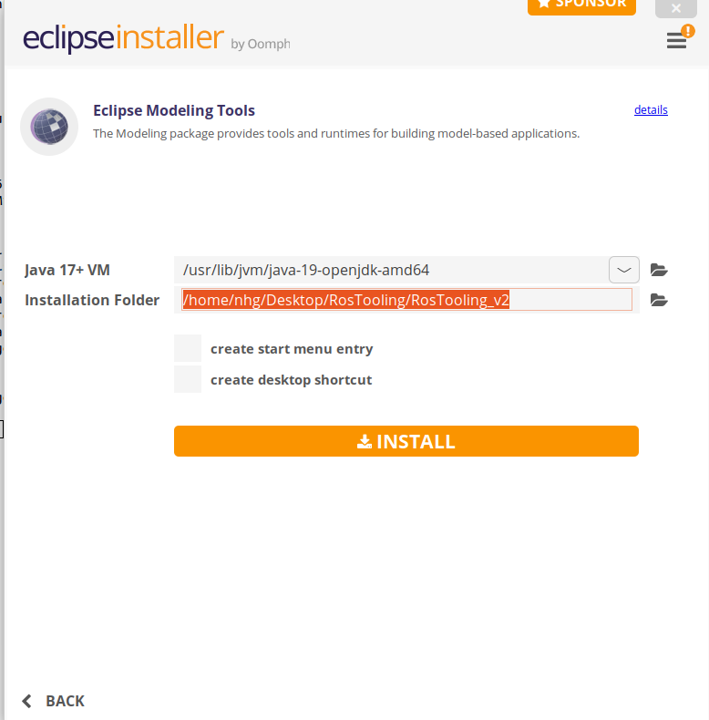
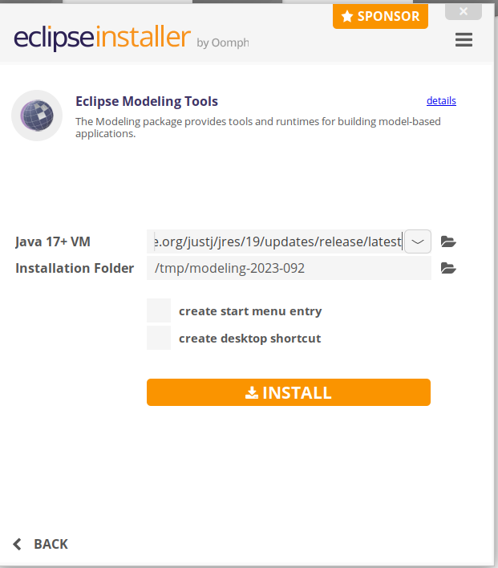
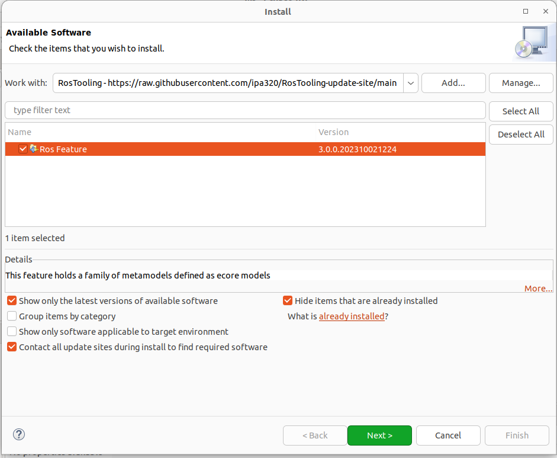
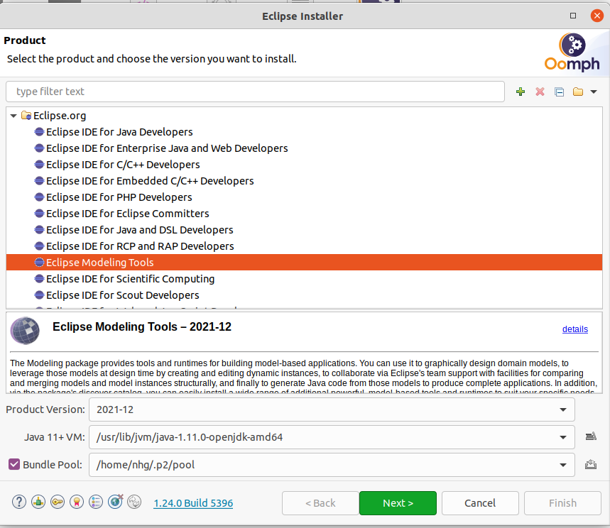
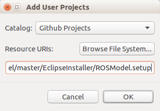
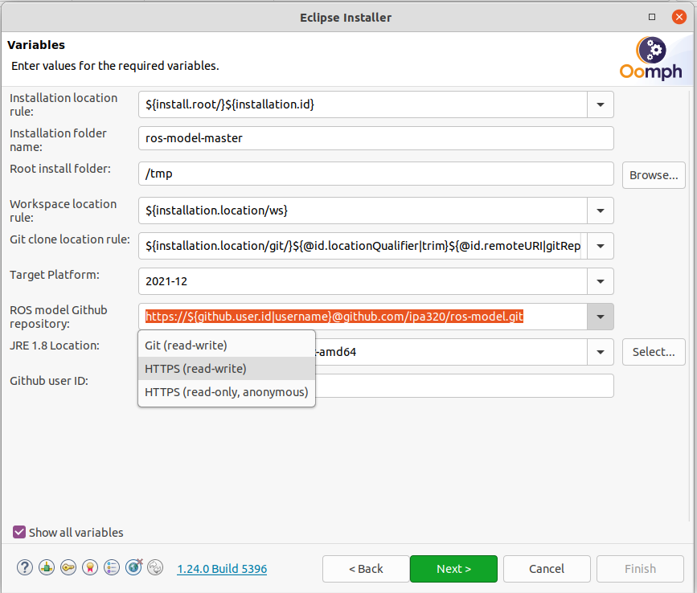

# Installation

RosTooling is installed as an extension of Visual Studio Code. The Eclipse application of earlier releases still works and is described [at the end of this page](#eclipse-legacy).

## VS Code

You need three things.

| | |
| --- | --- |
| Visual Studio Code | Version 1.107.0 or later, or another editor that runs VS Code extensions such as VSCodium. |
| Java | JDK 21 or later, because the language server is a Java program. |
| ROS 2 | Only to build and run generated packages. See [Target distributions](TargetDistributions.md) for the supported ones. |

On Ubuntu, Java is installed with:

```bash
sudo apt-get install openjdk-21-jdk
```

Then install the extension `RosTooling.rostooling-languages`. VSCodium and other editors that use Open VSX find it in the Extensions view. For the Microsoft build of VS Code, download the `.vsix` file of a release and install it with **Extensions: Install from VSIX...**. Both ways, and building from source, are described in [VS Code Extension: overview and installation](../vscode/overview.md#installation).

Open a folder with RosTooling files, or an empty folder, and continue with [Getting started](../vscode/getting-started.md).

## Eclipse (legacy)

```{note}
The Eclipse application is no longer developed further. New features, such as the diagram editor, the code generators for the newest ROS 2 distributions and the plugins, are available in VS Code only. The Eclipse editors keep working for existing projects. The update site below offers an older release of the application, so check what it contains before you rely on it.
```

The models are the same files in both tools, so you can edit a project in Eclipse and in VS Code. The Eclipse application needs Java 21 or later as well. The old tutorials are available in this site only for VS Code, the first steps for Eclipse are in [Set up the Eclipse application](Environment_setup.md).


### Install from the update site

First, the Java environment has to be set. For Linux it can be installed with the following command:

```
sudo apt-get install openjdk-21-jre
```

Then Eclipse can be installed. Please download the installer from the official Eclipse [website](https://www.eclipse.org/downloads/packages/installer). After unpacking the downloaded file, the installer can be run by calling the command *./eclipse-inst* from the console. 

Once you start the installer, select the package "Eclipse Modeling Tools". You can find it just by scrolling or using the searching tool:



Press next, and then pick the Java version 21 and the folder where you would like to install Eclipse.



Continue the installation, accepting the license, as usual.

Once the installation is completed, go to *Help* > *Install New Software...*. To install the latest version of the ROS tooling, add the update site URL `https://raw.githubusercontent.com/ipa320/RosTooling-update-site/main/site.xml` in the *Work with* section.



If no package is listed, please uncheck the option *Group items by category*. The category *ROS Model* appears in the *Name* area. Check the box in front of *ROS model* and click *Next* to review the list of items to be installed. Click *Next* again to read and accept the terms of the license agreements and afterwards click *Finish*. Eclipse will then start to install the ROS tooling and its dependencies. If you get a security warning about the authenticity, click OK. Finally, when asked, restart Eclipse to complete the installation process.

To start using the ROS tooling continue with [step 1](Environment_setup.md#switch-to-the-ros-developer-perspective)


### Install from source

First, the Java environment has to be set:
```
sudo apt-get install openjdk-21-jre
```
Download the official [Eclipse Installer](https://www.eclipse.org/downloads/packages/installer) for your preferred operating system. Execute the installer and choose the advanced mode (menu on the right-up corner). Select the Product *Eclipse Modeling tools* package. And then pick the Java version 21.



Press *Next* and add a new _User project_ by pressing the green button *+*:
```
Catalog: Github Projects
Resource URIs: https://raw.githubusercontent.com/ipa320/RosTooling/main/EclipseInstaller/ROSModel.setup
```
Sometimes Eclipse is not able to find the file, for those cases, we recommend downloading the file to the local memory of the machine and importing it:

```
wget https://raw.githubusercontent.com/ipa320/RosTooling/main/EclipseInstaller/ROSModel.setup
```



Select the ROS Model project (under GitHub Projects -> <User>) and press next.

By default, the ROS tooling installation will be saved under the folder *ros-model-master* in your home directory. To ensure that you have access to get the source code from GitHub, select the check box *Show all variable* and change the *Ros model GitHub repository* to the *HTTPs(read-write)* option, verify that the option *Github user ID* is set to "anonymous".



Follow the installation instructions of the Oompth installer dialog, after the installation eclipse will be restarted to launch the ROS tooling configuration. Finally, when all the startup tasks are finished press "Workbench".

To start using the ROS tooling continue with [step 0](Environment_setup.md)
