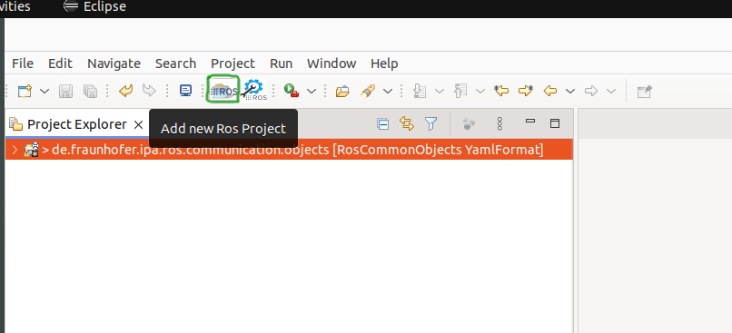

# Review package models

In this tutorial you write a small package model, `.ros2`, and meet the help that the editor gives: the naming rules, the error for a type that does not exist, completion, and what happens with a grammar error. It takes about 15 minutes.

**What you need:** the [VS Code extension](../vscode/overview.md). The message types come from the [catalogue](../vscode/catalogue.md), which the extension downloads when it starts. If you use Eclipse, the same models and messages apply; the tabs below show the differences.

## 1. Create the model file

::::{tab-set}
:::{tab-item} VS Code
Open an empty folder in VS Code (**File → Open Folder**), create a file with **File → New File** and name it `my_first_package.ros2`. The extension recognises the extension `.ros2` and switches on the editor features of the [package language](RosModelDescription.md). Right-click the file and choose **Open in RosTooling Visual Studio** whenever you want to see it as a diagram.
:::
:::{tab-item} Eclipse
Create a new project with the icon **Add new ROS Project**, or with **File → New → Other…** and **Ros Model Project**. The project refers to `de.fraunhofer.ipa.ros.communication.objects` and has a folder `rosnodes` with an empty `.ros2` file, which shows an error until you fill it. See [Eclipse setup](Environment_setup.md).


:::
::::

## 2. The naming rules

Paste this into the file:

<!-- check: group=names file=my_first_package.ros2 expect="Capital letters are not allowed" -->
```text
my_Component:
  artifacts:
    Component:
      node: Test
```

The editor underlines the first line as an error: "The name of a package has to follow the ROS naming conventions: Capital letters are not allowed". Hover over the underline to read it. The rules come from [REP 144](https://ros.org/reps/rep-0144.html): a name consists of lowercase letters, digits and underscores, and starts with a letter. For the artifact `Component` and the node `Test` the same rule is only a warning: "The name of a artifact should follow the ROS naming conventions: Capital letters are not recommended".

Fix the names, `my_component`, `component` and `test`, and the problems are gone.

## 3. A type that does not exist

Replace the content with a node that has a publisher. The type is wrong on purpose:

<!-- check: group=type file=my_first_package.ros2 expect="Couldn't resolve reference to TopicSpec" -->
```text
my_component:
  artifacts:
    component:
      node: test
      publishers:
        string_pub:
          type: "my_msgs_package/msg/String"
```

The error is "Couldn't resolve reference to TopicSpec 'my_msgs_package/msg/String'": the type is not defined anywhere that RosTooling can see. The message also names two ways to fix it, to add the project that defines the type or to generate a `.ros` model for it, see [Communication objects](NewCommunicationObjects.md).

To use an existing type, delete the text between the quotes and press `Ctrl+Space`. The editor lists the types of the catalogue. Choose `std_msgs/msg/String` and the error disappears. To see where a type is defined, put the cursor on it and use **Go to Definition** (`F12`, in Eclipse `F2`).

## 4. A grammar error

The last kind of error is a mistake in the grammar. Add a parameter without a type:

<!-- check: group=grammar file=my_first_package.ros2 expect="must be set" -->
```text
my_component:
  artifacts:
    component:
      node: test
      publishers:
        string_pub:
          type: "std_msgs/msg/String"
      parameters:
        my_bool:
```

This time the messages are more technical: the parser reports "no viable alternative at input" and says that "The required feature 'type' of 'ParameterImpl' must be set". They mean that a parameter needs a type. Add it under `my_bool` and use `Ctrl+Space` to see the choices:

<!-- check: group=final file=my_first_package.ros2 -->
```text
my_component:
  artifacts:
    component:
      node: test
      publishers:
        string_pub:
          type: "std_msgs/msg/String"
      parameters:
        my_bool:
          type: Boolean
          default: true
```

## 5. See it as a diagram

Right-click the file and choose **Open in RosTooling Visual Studio**. The Studio shows the package as a form: the node `test` with its publisher `string_pub` and its parameter `my_bool`. Everything you change there is written to the text.

```{image} images/tut_component.png
:alt: The Component view of the finished model
:width: 100%
```

## Next

Now you know how the editor and the validator work. Look at larger models: [Package language](RosModelDescription.md) describes all features, and the [catalogue](../vscode/catalogue.md) has many real ROS 2 nodes. The next tutorial combines nodes in a [system](LearnRosSystemModels.md).
