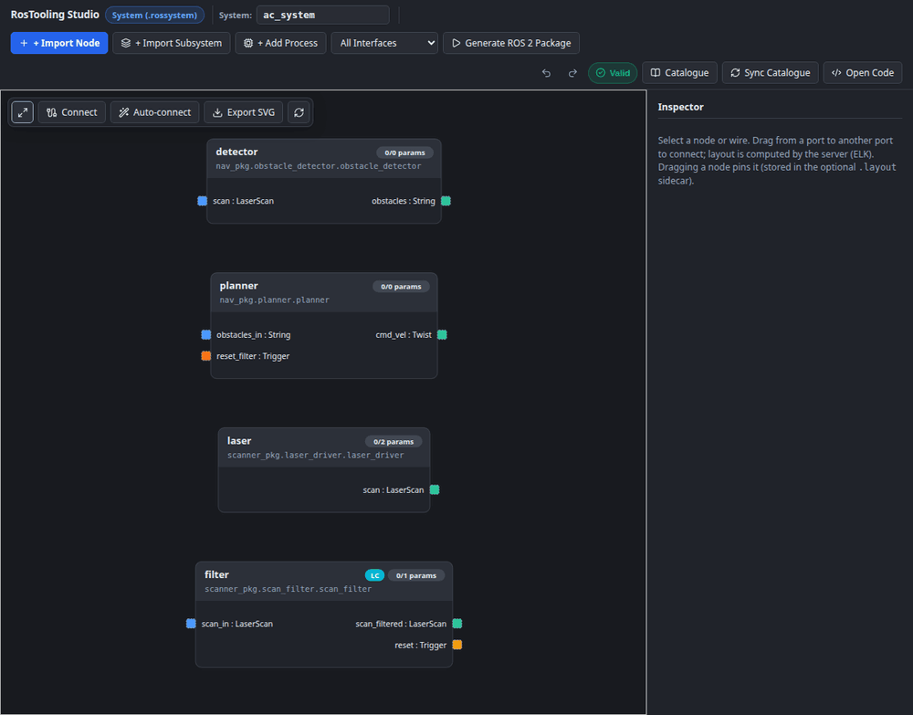

# Auto-connect

Auto-connect proposes the connections between the nodes of a system, so that you do not have to wire them one by one. It looks at the receivers, the subscribers, service clients and action clients, and for each of them lists the senders that fit. You choose, and the Studio adds all chosen connections in one step.

## Using it

Click **Auto-connect** on the canvas of the System view. A dialog opens, headed by the number of open receivers, with the nodes of the system in groups.



```{image} images/studio-autoconnect-full.png
:alt: The Auto-connect dialog with the proposals for four receivers
:width: 100%
```

- Each receiver port, a subscriber, a service client or an action client, has its own box with the kind of the port, its name and its type. In it, every candidate sender is a line with a radio button, the sender as `<node>::<interface>`, its rank on the right, and the evidence under it, for example "similar names 'scan' ~ 'scan_in' (1.00)". **Leave unconnected** is always an option.
- At most one candidate is preselected, and only when the evidence is strong, see below.
- A topic subscriber can take several publishers: under **add another publisher** a check box for each further candidate adds it. A service client or an action client connects to one server at a time.
- **Show emitter fan-out** (or Hide) lists every sender with its type and the number of connections it has, as `existing + chosen here → total`.
- A collapsible list shows the ports that were skipped, with the reason, for example an interface of a subsystem that has not been exposed.
- When you hover over a candidate, the two ports are highlighted on the canvas.
- **Add N connections** adds all chosen connections as one change. A message says "Added N connections (Undo reverts the whole batch)", so one undo removes them all. The dialog stays open and lists the receivers that are still open.

While the dialog is open it follows the model: after an undo, a redo or any other change, it refreshes and keeps the choices that you made.

## How candidates are found

All rules come from the model server, the same server that checks the connections you draw by hand, so a proposal is always a connection that the validator accepts.

**Which ports are candidates.** A candidate is decided by compatibility, not by name: the two ports must have complementary kinds (publisher and subscriber, service server and client, action server and client) and the same resolved type. Two ports of the same node, or of the same subsystem, are never connected to each other.

**Ranking.** The candidates of a receiver are ordered by what their names say. From the strongest to the weakest:

| Rank | Meaning |
| --- | --- |
| `remap` | both ports are remapped to the same name |
| `directed-remap` | one port is remapped to the interface name of the other |
| `contract` | both have the same interface name, and neither is remapped |
| `fuzzy` | the names are similar after case, namespaces, separators and common endings such as `_in`, `_out` and `_raw` are ignored |
| `type-unique` | the sender is the only one that is compatible with the receiver |
| `type-ambiguous` | the sender is one of several that are compatible |

A candidate is preselected only if its rank is `remap`, `directed-remap` or `contract`, and it is the only candidate of the receiver with that rank.

**Ports of the system.** The nodes of the system offer the interfaces that the system lists for them, and the interfaces of their component that the system does not rename, which are added to the system when a connection uses them. The nodes inside a subsystem offer only the interfaces that their own file declares. A port that a subsystem has not exposed yet is not proposed; it appears in the list of skipped ports with the reason "not exposed by" the subsystem, because using it would change the file of the subsystem.

**Already connected.** A receiver that already has a connection is left out and listed as connected.

## Auto-connect with an AI agent

The MCP tool `ros_auto_connect` does the same without the dialog. By default it is a dry run that returns the proposals. With `apply` it adds the chosen connections, and returns the ids that were added, the ids that were rejected and why, and the errors and warnings of the model. See [MCP server and agent skills](mcp-and-agents.md).
