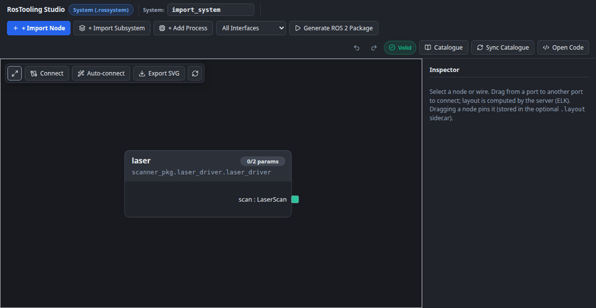
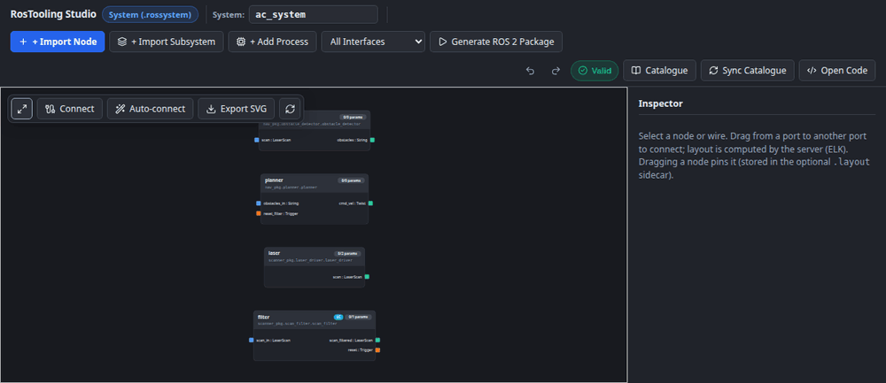

# Getting started

This page goes through the whole path once: open a system model in the diagram, change it, generate a ROS 2 package and build it. Each step has a page of its own with the details.

## 1. Open a model in RosTooling Studio

Open a folder that contains RosTooling files in VS Code. A `.rossystem` file is the best start. Then do one of these:

- right-click the file in the Explorer or in the editor and choose **Open in RosTooling Visual Studio**,
- click the graph icon in the title bar of the editor,
- run **RosTooling: Open in RosTooling Visual Studio** from the Command Palette (`Ctrl+Shift+P`).

The file opens as a diagram. The text editor stays available: the **Open Code** button of the Studio shows the text, and the diagram and the text always show the same model. A file opens as text by default, so the diagram is a choice you make for each file.

## 2. Add nodes and connect them

In the System view, **+ Import Node** opens the catalogue: search it, and choose **Import** on a node to add it. The nodes come from the `.ros2` models of your workspace and from the catalogue of ready models, see [Catalogue](catalogue.md). Each node shows its interfaces as ports.



Connect a publisher to a subscriber (or a service server to a client, or an action server to a client) by dragging from a port to another, or with the **Connect** button. The Studio only lets you connect ports of the right kind and the same type.



To let the Studio propose the connections that fit, use **Auto-connect**, see [Auto-connect](auto-connect.md).

## 3. Check the model

The pill in the toolbar shows **Valid**, or the number of errors and warnings. Click it to see them. The same diagnostics are in the Problems view when the file is open as text. See [Validation and diagnostics](../docu/Validation.md) for what is checked.

```{image} images/studio-system.png
:alt: A valid system in RosTooling Studio
:width: 100%
```

## 4. Generate the package

Click **Generate ROS 2 Package** in the toolbar of the Studio, or right-click a `.rossystem` file and choose **Generate ROS2 Package**. The package with the launch file is written to `src-gen/` in your workspace. For the nodes of a `.ros2` model, right-click the file and choose **Generate ROS 2 Node Wrappers**. See [Generate and build](generate-and-build.md).

## 5. Build and run

Copy or link the generated packages into the `src/` folder of a ROS 2 workspace, then build in a terminal in which ROS 2 is sourced:

```bash
colcon build --symlink-install
source install/setup.bash
```

Then start the system:

```bash
ros2 launch <system> <system>.launch.py
```

The next pages describe each part: [Editing models](editing-models.md), [RosTooling Studio](studio.md), [Auto-connect](auto-connect.md), [Generate and build](generate-and-build.md), [Catalogue](catalogue.md), [Plugins](plugins.md), [MCP server and agent skills](mcp-and-agents.md) and the [reference](reference.md).
