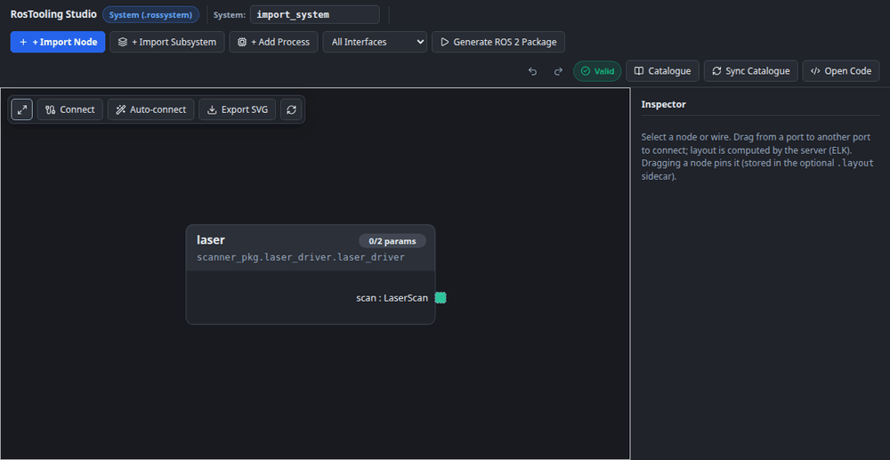
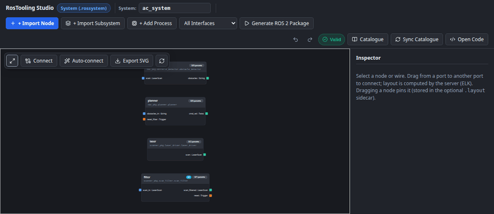

# RosTooling Studio

RosTooling Studio is the diagram editor of the extension. It opens a RosTooling file as a graph or a set of forms, and every change you make in it is written to the text file. The model server that checks and lays out the diagram is the same that the text editor uses.

```{image} images/studio-system.png
:alt: The System view of RosTooling Studio with three nodes and two connections
:width: 100%
```

## Opening

Right-click a `.rossystem`, `.ros2`, `.ros1` or `.ros` file and choose **Open in RosTooling Visual Studio**, use the graph icon in the title bar of the editor, or run **RosTooling: Open in RosTooling Visual Studio**. A file opens as text by default; the Studio is an additional way to look at it. **Open Code** in the toolbar returns to the text.

There are three views, one for each kind of file.

| File | View | Shows |
| --- | --- | --- |
| `.rossystem` | System | The nodes of a system as boxes with their interfaces as ports, the connections as wires, subsystems and processes. |
| `.ros2`, `.ros1` | Component | The nodes of a package, with their interfaces, parameters, quality of service, plugin bases, slots and plugins. |
| `.ros` | Communication objects | The messages, services and actions of a package with their fields. |

## The toolbar

The toolbar changes with the view. In every view:

| Control | What it does |
| --- | --- |
| model name | Shows the name of the system or package. Edit it to rename the model. |
| Undo, Redo | Undo and redo changes made in the Studio (`Ctrl+Z`, `Ctrl+Shift+Z`). |
| Diagnostics pill | Shows **Valid**, or the number of errors and warnings of the model. Click it to see the list. |
| Catalogue | Opens the [catalogue](catalogue.md) of nodes, subsystems and types. |
| Sync Catalogue | Updates the catalogue from GitHub. |
| Open Code | Opens the text of the file. |

In the System view:

| Control | What it does |
| --- | --- |
| + Import Node | Adds a node from the catalogue or the workspace. |
| + Import Subsystem | Adds another system as a subsystem. |
| + Add Process | Adds a process, a container in which nodes run together. |
| interface filter | Shows only the ports and wires of one kind: topics, services or actions. |
| Generate ROS 2 Package | [Generates the package](generate-and-build.md) of the system. |

On the canvas of the System view there are also **Fit view**, **Connect**, **Auto-connect**, **Export SVG** and a reload button.

In the Component view the toolbar has **+ Add New Node**, the interface filter and **Generate Wrappers**. In the Communication objects view it has **+ Message**, **+ Service**, **+ Action** and a category filter.

### Diagnostics

When the model has errors or warnings, the pill shows their number. Click it for the list. Each entry has the severity and the message of the [validator](../docu/Validation.md). A connection with an error is marked on the canvas.

```{image} images/studio-diagnostics.png
:alt: The diagnostics list for a connection between interfaces of different types
:width: 100%
```

## The System view

**Layout.** The diagram is laid out automatically, from the senders on the left to the receivers on the right, and the wires are routed in right angles around the nodes. You can drag a node to another place. A node that you moved keeps its place, and the places are stored in a file next to the model, `<model file>.layout`. Wires that cross show a small jump.

**Adding nodes.** **+ Import Node** opens the [catalogue](catalogue.md) with the nodes of your workspace and of the catalogue. **Import** on a node adds it to the system, as an entry under `nodes:`.



**Connecting.** Click **Connect**, then a source port and a target port, or drag from one port to another. The Studio only accepts a publisher with a subscriber, a service server with a service client, and an action server with an action client, with the same type. The text file gets the connection with the interfaces that it needs, written as `<node>::<interface>`:



```text
  connections:
    - [ "laser::scan" , "filter::scan_in" ]
```

To change a connection, select the wire and drag one of its end handles onto another port; **Delete connection** removes it. To let the Studio propose connections, use [Auto-connect](auto-connect.md).

**Subsystems.** A subsystem is drawn as a dashed frame with the nodes of the other system inside, with a button to collapse it to its boundary ports. You can wire to the interfaces of the nodes inside. The Studio writes such a connection with the qualified name, `<subsystem>::<node>::<interface>`. When a connection needs an interface that the subsystem has not exposed yet, the Studio adds it to the subsystem's model.

```{image} images/studio-subsystem.png
:alt: A subsystem frame with its nodes and a connection to a node of the outer system
:width: 100%
```

**Processes.** A process is drawn as a box with its name and its number of threads. Select it to rename it, change the threads and choose its member nodes, which are listed with a check box each. See [System generation](../docu/CodeGeneration.md#processes) for what a process does.

```{image} images/studio-inspector-process.png
:alt: The inspector of a process with its name, executor threads and member nodes
:width: 100%
```

**The inspector.** Selecting an element shows its properties in the side panel, and the entries can be edited:

| Selected | You can |
| --- | --- |
| nothing | add, edit and remove the `@` blocks of the system that [plugins](plugins.md) provide |
| a node | change its name and namespace, see the component it comes from and open its model, rename (expose) its interfaces, set parameter values, see the plugins attached to each slot, edit its `@` blocks |
| a connection | see its kind and both ends, reconnect it, delete it |
| a process | change its name and threads, choose its member nodes |
| a subsystem | collapse or expand it, open its model, remove it |

```{image} images/studio-inspector-node.png
:alt: The inspector of a node with its name, namespace, component and interfaces
:width: 100%
```

The name of the system is changed in the toolbar. A node inside a subsystem is read-only: open the model of the subsystem to change it. Parameter values are checked against the declared type when you enter them.

**Exporting.** **Export SVG** saves the laid-out diagram as an SVG file.

## The Component view

The Component view edits a `.ros2` or `.ros1` package as forms.

```{image} images/studio-component.png
:alt: The Component view with the package, its nodes and the form of one node
:width: 100%
```

The left side is about the package:

- **Package Metadata**: the name of the package and its Git repository, `fromGitRepo`.
- **Component Nodes**: the nodes of the package. **New** adds one, and selecting one shows its form. A lifecycle node has an **LC** badge.
- **Plugin Libraries** and **Plugin Bases**: the artifacts that hold [plugins](../docu/PluginConcepts.md), and the plugin bases of the package, each with a **New** button.
- **Generate ROS 2 Wrappers**, which [generates the code](generate-and-build.md) of the package.

The form of the selected node has these parts:

- the input ports and output ports at a glance, and the buttons **Duplicate** and **Delete Node**,
- **Node Identity & Lifecycle**: the name of the node, the name of the artifact (the executable), and the check box that makes the node a lifecycle node,
- **Plugin Slots**, with **Add Slot**,
- **Interfaces**: the buttons **Publisher**, **Subscriber**, **Service Server**, **Service Client**, **Action Server** and **Action Client** add an interface. Each interface has its kind, name, type and namespace, and a section for the quality of service with the entries described in [Package language](../docu/RosModelDescription.md#quality-of-service). **Browse ROS Types** helps to find a type,
- the parameters, with their types and defaults.

## The Communication objects view

The Communication objects view edits a `.ros` file.

```{image} images/studio-comm-objects.png
:alt: The Communication objects view with a message and a service
:width: 100%
```

The left side has the name of the interface package, a search field for definitions and fields, **Msg**, **Srv** and **Action** buttons for new types, the list of the definitions, and **Browse Standard ROS Types**. Every definition is a card with its name and its full name, such as `my_msgs/msg/Hello`. Its fields have a type and a name. The check box `[]` makes a field an array, and the field next to it takes the size of a fixed-size array (which needs a newer RosTooling than the current release, see [Communication objects](../docu/NewCommunicationObjects.md#arrays)). **Add `message` field** (or `request`, `response`, `goal`, `result` and `feedback`) adds a field, and the red button deletes one.

## Read-only models

A model that comes from the catalogue is shown with a banner and cannot be edited, so that you do not change the shared library by accident. Copy it into your workspace to change it.

## Keeping text and diagram in sync

- Changes in the diagram are written to the file as small edits, so the comments and the formatting of the rest of the file stay as they are.
- Edits in the diagram are saved shortly after you stop typing in a field, and before undo, redo or switching away.
- A change in the text, or by another tool, is picked up and shown in the diagram. The same is true for the models that the open file refers to: saving a `.ros2`, `.ros` or `.rossystem` file updates the diagrams that use it.
- When a subsystem's model is saved, the parent systems that refer to it are updated, so that remapped connections do not break.
